<div align="center">



</div>

```console
vishal@siddha:~$ whoami
vishal v · systems, security and ai engineer · creator of sydra os

vishal@siddha:~$ cat ~/status
building   sydra-os   [in development]   arch-based glass desktop for builders and gamers
building   agan       [planning]         retrieval-first ai that runs on any machine
learning   assembly · llms · agents · unreal engine
```

| `~/links` | |
|---|---|
| **portfolio** | [ed-tech-0.github.io](https://ed-tech-0.github.io) |
| **sydra-os** | [github.com/ED-TECH-0/sydra-os](https://github.com/ED-TECH-0/sydra-os) |
| **agan** | [github.com/ED-TECH-0/agan](https://github.com/ED-TECH-0/agan) |
| **instagram** | [@0731_vengence](https://instagram.com/0731_vengence) |
| **email** | [vishal.0731.v@gmail.com](mailto:vishal.0731.v@gmail.com) |

<details>
<summary><code>$ ls ~/skills</code></summary>

<br>

```text
systems    arch linux · archiso · calamares · shell · termux · privilege rings
languages  rust · python · shell (working)    assembly (learning)
security   pentesting fundamentals · hacking methodology · linux hardening
ai         hermes · antigravity · ollama      llms · gguf · agents (learning)
game/3d    unreal engine basics (learning)
```

</details>

<details>
<summary><code>$ cat ~/mindset.txt</code></summary>

<br>

```text
1  question the default
2  think in layers
3  watch people first
4  stay with big questions
5  write ideas down
```

</details>

<details>
<summary><code>$ cat ~/contact.sh</code></summary>

<br>

Open to roles and conversations about linux customization, local ai and agent tooling, and security tooling.

```text
email      vishal.0731.v@gmail.com
alternate  edvengence2@gmail.com
```

</details>
