[**Portfolio**](https://ed-tech-0.github.io) · [**Sydra OS**](https://github.com/ED-TECH-0/sydra-os) · [**agan**](https://github.com/ED-TECH-0/agan) · [**Instagram**](https://instagram.com/0731_vengence) · [**Email**](mailto:vishal.0731.v@gmail.com)

**Systems, cybersecurity and AI engineer** · Creator of Sydra OS · Building agan

<b>About me</b>

 

I build Linux-based systems and security tooling, working with AI agents like **Hermes**, **Antigravity** and **Ollama**. I think in layers, question defaults, watch how people behave and learn by building. I also draw and write ballads and philosophy.

<b>What I’m building</b>

 

- [**Sydra OS**](https://github.com/ED-TECH-0/sydra-os): an Arch-based glass desktop for developers and gamers (KDE Plasma 6, Wayland, Calamares). *In development.*
- [**agan**](https://github.com/ED-TECH-0/agan): a retrieval-first AI assistant that fetches knowledge fresh and keeps skills in a small local model. *Planning and scaffolding.*

<b>Skills</b>

 

| Area | What |
|---|---|
| Systems | Arch Linux, archiso, Calamares, shell, Termux, privilege rings |
| Languages | Rust, Python, shell (working) · Assembly (learning) |
| Security | Pentesting fundamentals, hacking methodology, Linux hardening |
| AI | Hermes, Antigravity, Ollama · LLMs, GGUF, agents (learning) |
| Game and 3D | Unreal Engine basics (learning) |

<b>Contact</b>

 

Open to roles and conversations about Linux customization, local AI and agent tooling, and security tooling.
