**Systems, cybersecurity and AI engineer** · Creator of Sydra OS

[Email](mailto:vishal.0731.v@gmail.com) · [Instagram](https://instagram.com/0731_vengence) · [Sydra OS](https://github.com/ED-TECH-0/sydra-os)

---

## About

I build Linux-based systems and security tooling, working with AI agents like **Hermes**, **Antigravity** and **Ollama**. My focus is low-level systems, cybersecurity and local AI. I also draw and write poetry and philosophy.

## My creation

**Sydra OS** is an Arch-based Linux distribution for developers and gamers, with a glassmorphism desktop on KDE Plasma 6 and Wayland, a Calamares installer, an out-of-the-box gaming stack and a zero-friction developer workstation. Status: **in development**.

## Built with agents

| Agent | How I use it |
|---|---|
| **Hermes** | Planning, drafting and iterating on code |
| **Antigravity** | Agent-driven environment for building and refactoring |
| **Ollama** | Local models for private, offline experiments and security tooling |

## Skills

| Area | What |
|---|---|
| Systems | Arch Linux, archiso, Calamares, Shell, Termux, privilege rings |
| Languages | Rust, Python, Shell (working) · Assembly (learning) |
| Security | Pentesting fundamentals, hacking methodology, Linux hardening |
| AI | Hermes, Antigravity, Ollama · LLMs, GGUF, agents (learning) |
| Game & 3D | Unreal Engine basics (learning) |

## Research

- **Agathiyan AI** (planned): a local AI assistant for a future Rust core-level environment
- **Pentesting SML** (research): a small, locally runnable model for penetration-testing workflows
- **Continuous-voltage processor** (concept): an original architecture exploration with three core zones and a hardware scheduler

## Contact

Open to roles and conversations about Linux customization, local AI and agent tooling, and security tooling.
**vishal.0731.v@gmail.com** · Alternate: edvengence2@gmail.com
