[**Portfolio**](https://ed-tech-0.github.io) · [**Sydra OS**](https://github.com/ED-TECH-0/sydra-os) · [**agan**](https://github.com/ED-TECH-0/agan) · [**Instagram**](https://instagram.com/0731_vengence) · [**Email**](mailto:vishal.0731.v@gmail.com)

## What I can do

## What I’m building

**Sydra OS** is an Arch-based Linux distribution for developers and gamers: a glassmorphism desktop on KDE Plasma 6 and Wayland, a Calamares installer, a gaming stack with automatic GPU detection and a zero-friction developer workstation. Status: **in development**.

**agan** is a retrieval-first AI assistant: knowledge is fetched fresh from the internet with citations, while a small local model learns skills such as planning, searching, reasoning, using tools and checking its own work. It is designed to scale from a 4 GB laptop to a workstation GPU. Status: **planning and scaffolding**.

## Security and AI

<table>
<tr>
<td width="50%" valign="top">

### Cybersecurity

I believe cybersecurity decides how far we can trust software and AI, so I treat it as a core craft.

- Think like an attacker to defend better
- Hardening, secure defaults and easy recovery
- The human side: most breaches start with people
- Building tools, plus research on a small local model for pentesting
- Guarding AI itself as agents gain power

</td>
<td width="50%" valign="top">

### AI

I use AI as a builder’s partner, and I’m learning to build it too.

- Agents in my build loop: Hermes and Antigravity
- Local-first with Ollama: private and offline
- Understanding LLMs, GGUF and local inference
- Small focused models for one job
- AI for defenders, security for AI

</td>
</tr>
</table>

<b>How my thinking helps tech</b>

 

| Habit | Where it shows up |
|---|---|
| Question the default | Asking why chips waste energy switching led to my continuous-voltage processor concept |
| Think in layers | OS stacks, modular packages and design tokens that stay easy to change |
| Watch people first | Interfaces that explain themselves, and security that accounts for human behavior |
| Wide curiosity | Art, philosophy and engineering together give tools an identity |
| Agents multiply one builder | Hermes, Antigravity and Ollama let me prototype and test ideas quickly |
| Access matters | Technology should work for people in their own language and on their own terms |

<b>Skills and tools</b>

 

| Area | What |
|---|---|
| Systems | Arch Linux, archiso, Calamares, shell, Termux, privilege rings |
| Languages | Rust, Python, shell (working) · Assembly (learning) |
| Security | Pentesting fundamentals, hacking methodology, Linux hardening |
| AI | Hermes, Antigravity, Ollama · LLMs, GGUF, agents (learning) |
| Game and 3D | Unreal Engine basics (learning) |

<b>Research and concepts</b>

 

- **Pentesting SML** (research): a small, locally runnable model for penetration-testing workflows
- **Continuous-voltage processor** (concept): always-on “1”, 0 as a control state, three core zones and a hardware scheduler to cut idle switching waste and heat
- **Rust core-level track** (next): a Rust core working with system calls, registers and assembly

<b>Art and words</b>

 

I draw and write ballads and philosophy, and I think through ideas as dialogues between viewpoints. I share them on [Instagram](https://instagram.com/0731_vengence).

Open to roles and conversations about Linux customization, local AI and agent tooling, and security tooling.

[vishal.0731.v@gmail.com](mailto:vishal.0731.v@gmail.com) · Alternate: edvengence2@gmail.com

